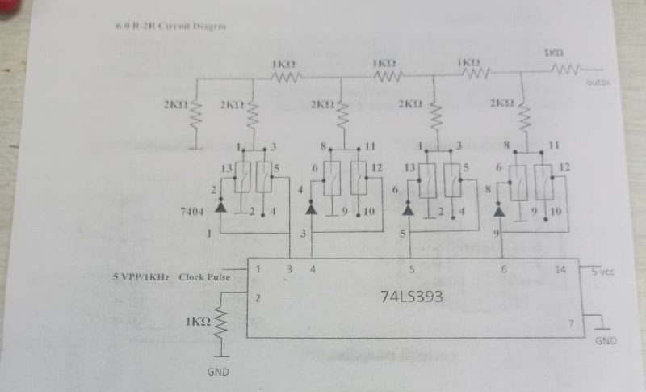
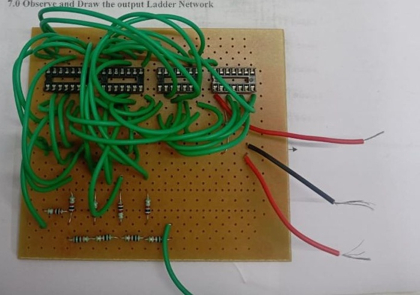

# IIT Madras – Advanced Electronics Manufacturing Training | Week 1

A documented record of my first week in the Advanced Electronics Manufacturing Training Program at the Central Electronics Centre (CEC), IIT Madras, covering KiCad schematic and PCB design, PCB fabrication workflow, through-hole soldering, analog and power electronics, and an R-2R ladder DAC.

This is a personal learning portfolio. It is **not** an official IIT Madras document and is not endorsed by the institute. It separates what the supplied images show from what I learned as concepts and from what would still need measurement.

## Contents

1. [Training context](#training-context-and-objectives)
2. [Technical skills](#technical-skills-overview)
3. [Visual gallery](#visual-gallery)
4. [PCB design workflow](#pcb-design-workflow-using-kicad)
5. [PCB fabrication workflow](#pcb-fabrication-workflow)
6. [Analog electronics](#analog-electronics-learning)
7. [Power electronics](#power-electronics-learning)
8. [R-2R ladder DAC](#r-2r-ladder-dac)
9. [Soldering and assembly](#through-hole-soldering-and-circuit-assembly)
10. [Concepts, challenges, outcomes](#key-technical-concepts-learned)
11. [Roadmap](#future-learning-roadmap) · [Navigation](#repository-navigation) · [Licensing](#licensing-and-attribution)

## Training context and objectives

| | |
|---|---|
| Programme | Advanced Electronics Manufacturing Training Program |
| Institution / location | IIT Madras, Central Electronics Centre (CEC) |
| Period | Week 1 |

**Objectives:** understand the schematic-to-PCB workflow in KiCad; understand how a design becomes a fabricated board; practise through-hole assembly; review analog and power-electronics fundamentals; and study digital-to-analog conversion with an R-2R ladder.

## Technical skills overview

- **EDA:** KiCad Schematic Editor, PCB Editor and 3D Viewer
- **PCB design:** symbols, nets, footprints, placement, routing, two-layer copper, board outline
- **Verification concepts:** ERC, DRC, 3D inspection
- **Manufacturing concepts:** Gerber and drill outputs, fabrication preparation
- **Assembly:** through-hole soldering, perfboard wiring, continuity-check practice
- **Analog and power:** passive components, polarity, boost-type switching-converter reading (UC3845, IRF540N)
- **Mixed-signal:** R-2R DAC theory, counter-driven ladder

## Visual gallery

| | |
|---|---|
|  |  |
| *KiCad schematic: UC3845 controller, IRF540N MOSFET, diode, inductor, feedback divider.* | *KiCad PCB layout: two-layer routing, 12 nets, 0 unrouted.* |
|  |  |
| *KiCad 3D Viewer used to inspect placement and physical component representation. The components match the design on the left, so this is the power-electronics board, not the R-2R circuit.* | *R-2R ladder DAC diagram: 74LS393 counter, 7404 stages, resistor ladder, clock input.* |

*Hand-wired R-2R ladder hardware on perfboard. The two R-2R images are crops of one supplied photograph; the [unaltered original](assets/images/r2r-ladder-worksheet-and-hardware-original.jpg) is kept alongside.*

## PCB design workflow using KiCad

Schematic capture → symbols and nets → footprint assignment → ERC → netlist to PCB → outline → placement → routing → DRC → 3D check → Gerber and drill output. The screenshots evidence schematic capture, placement, two-layer routing and 3D inspection; ERC, DRC and output generation are understood as concepts only. See [doc 02](docs/02-pcb-design-using-kicad.md).

## PCB fabrication workflow

From verified Gerber and drill files through fabricator DFM checks, fabrication, incoming inspection, assembly and bring-up. No fabrication files were supplied, so none are included. See [doc 03](docs/03-pcb-fabrication-workflow.md).

## Analog electronics learning

Resistors, capacitors, inductors, diodes, V/I/R/P relationships, polarity and schematic reading, and the gap between ideal and real components. See [doc 04](docs/04-analog-electronics-fundamentals.md).

## Power electronics learning

The supplied KiCad design pairs a UC3845 controller with an IRF540N, inductor, diode, output capacitor and feedback divider; the visible topology matches a **boost-type converter**. The analysis covers gate drive, losses, component ratings, layout and safety. Operating voltages, frequency and performance are **not known**, and no testing is claimed. See [doc 05](docs/05-power-electronics-learning.md).

## R-2R ladder DAC

A clocked 74LS393 counter feeds 7404 stages and a resistor ladder (5 × 2 kΩ, 4 × 1 kΩ in the diagram). The documentation derives the ideal output

$$V_{out}=V_{ref}\,\frac{D}{2^{N}}$$

with its assumptions stated, and discusses tolerance, loading and logic-level effects. Pin-level wiring and bit order cannot be reliably read from the photo, and no measured output exists. See [doc 06](docs/06-r2r-ladder-dac.md).

## Through-hole soldering and circuit assembly

Lead and pad identification, polarity, heating and solder application, joint quality, inspection and safety. The perfboard photo illustrates hand assembly. No assessment or measurements were supplied. See [doc 07](docs/07-through-hole-soldering.md).

## Key technical concepts learned

| Concept | Why it matters |
|---|---|
| Schematic ↔ PCB linkage | Keeps intent and layout consistent |
| Footprint correctness | Wrong land pattern means an unusable board |
| 3D view limits | Checks geometry, not electrical correctness |
| ERC/DRC limits | Pass means "not obviously wrong", not "works" |
| Boost-converter energy flow | Inductor stores energy, diode and capacitor deliver it |
| R-2R ratio principle | Binary weighting from only two resistor values |

## Challenges and practical engineering considerations

- Reading a dense, hand-wired perfboard is hard; a designed PCB is easier to verify.
- Power layouts need attention to current loops, track width and noise.
- Ladder accuracy depends on resistor matching and logic output levels.
- The screenshot design shows no visible input/output connectors, which would need adding in a revision.
- A label in the schematic (L1 "10uf") appears to use a capacitance unit for an inductor.

## Learning outcomes

I can explain the schematic-to-PCB workflow, read the supplied power-stage schematic and describe its likely function, explain R-2R operation and its error sources, and describe a sound soldering and inspection procedure. I have **not** claimed measured results, completed fabrication, or advanced proficiency.

## Future learning roadmap

Goals only, not achievements: advanced KiCad workflows, DRC discipline, manufacturing outputs, datasheet interpretation, soldering inspection, multimeter and oscilloscope verification, R-2R error analysis, switching-converter fundamentals, embedded integration and revision control. Details in [doc 08](docs/08-key-takeaways-and-future-learning.md).

## Repository navigation

| Document | Topic |
|---|---|
| [01 Week 1 Learning Overview](docs/01-week-1-learning-overview.md) | Context, evidence labels, image mapping |
| [02 PCB Design Using KiCad](docs/02-pcb-design-using-kicad.md) | Schematic-to-PCB workflow |
| [03 PCB Fabrication Workflow](docs/03-pcb-fabrication-workflow.md) | Design to manufactured board |
| [04 Analog Electronics Fundamentals](docs/04-analog-electronics-fundamentals.md) | Components and schematic reading |
| [05 Power Electronics Learning](docs/05-power-electronics-learning.md) | UC3845 / IRF540N design analysis |
| [06 R-2R Ladder DAC](docs/06-r2r-ladder-dac.md) | Theory, diagram, hardware |
| [07 Through-Hole Soldering](docs/07-through-hole-soldering.md) | Process, inspection, safety |
| [08 Key Takeaways and Future Learning](docs/08-key-takeaways-and-future-learning.md) | Reflection and roadmap |

## Licensing and attribution

- Original written text is under the MIT licence in [LICENSE](LICENSE).
- **Images are excluded from that licence.** The printed R-2R diagram carries a header naming another institution and appears to come from third-party lab material; the KiCad screenshots show KiCad and third-party symbols and 3D models. Confirm your right to publish before making the repository public, or replace the diagram with your own redraw.
- No source KiCad, Gerber, drill, BOM or simulation files are included.

## Acknowledgements

Thanks to the faculty, mentors and staff of the Central Electronics Centre, IIT Madras, for the instruction and guidance in this training week.

## Closing

This repository records a structured first week that combined design tools with hands-on hardware. It is intended to show honest understanding and a clear plan for building measurable, verified skills in the weeks ahead.
