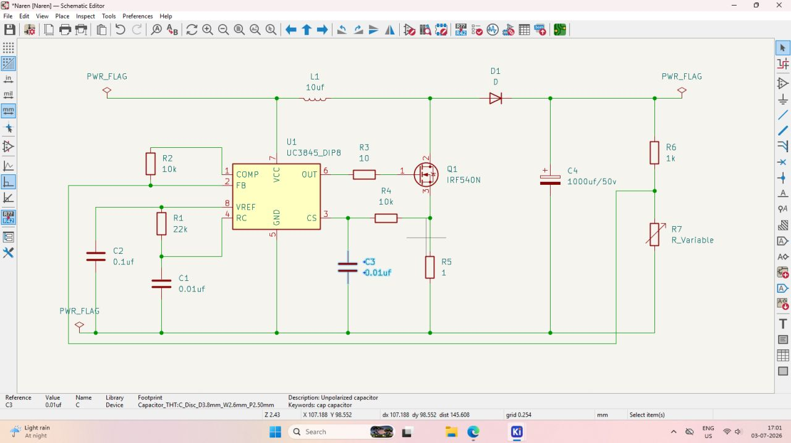
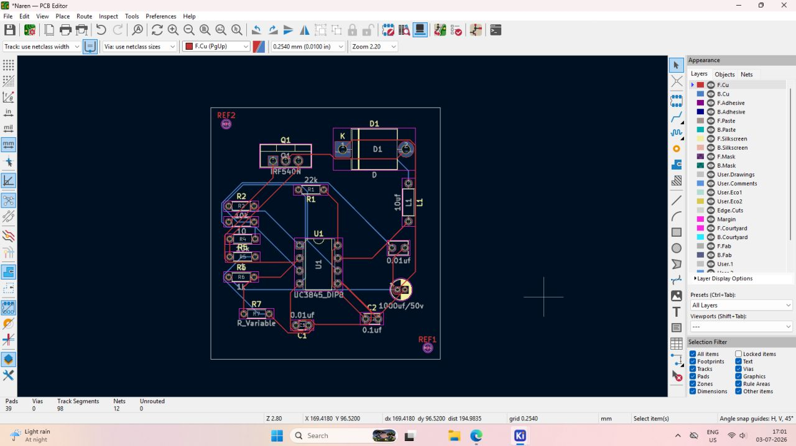
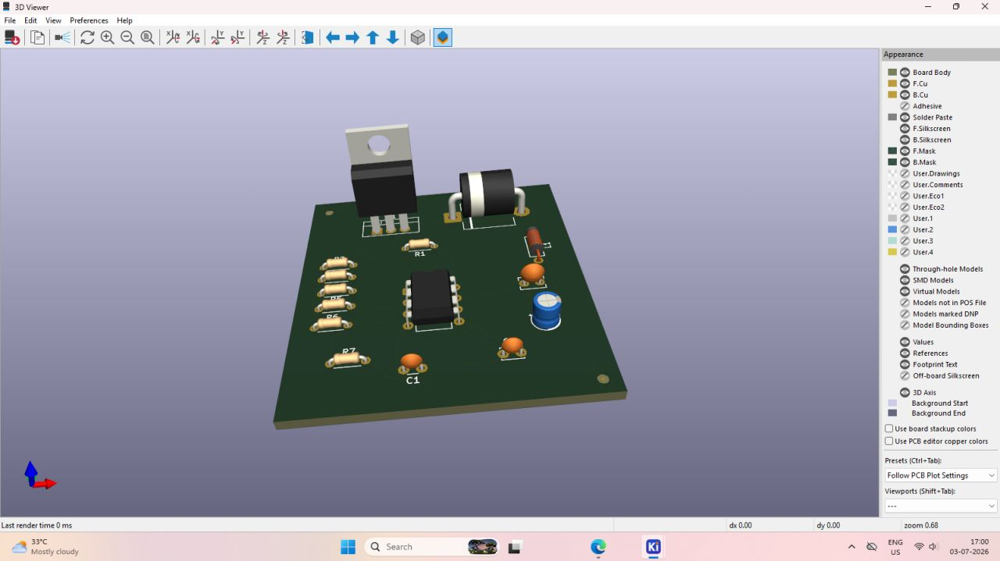

# 05 · Power Electronics Learning

[← Analog Electronics](04-analog-electronics-fundamentals.md) · [README](../README.md) · Next: [R-2R Ladder DAC →](06-r2r-ladder-dac.md)

> **Scope and honesty note.** The analysis below is based **only on the visible schematic and PCB screenshots**. No input voltage, output voltage, switching frequency, power rating, efficiency, waveform, or test result was supplied. Nothing here claims that the circuit was built, powered or successfully operated.

## Why power electronics matters in manufacturing

Almost every electronic product needs conversion between voltage levels. Power stages carry large currents, switch fast and dissipate heat, so they test PCB layout, component ratings and assembly quality more than most low-speed circuits.

## The supplied design

*Figure 1. KiCad Schematic Editor screenshot.*

### Components visible

| Ref | Value / label | Notes |
|---|---|---|
| U1 | UC3845_DIP8 | Current-mode PWM controller |
| Q1 | IRF540N | N-channel power MOSFET |
| D1 | "D" | Generic diode symbol; no part number |
| L1 | "10uf" | Inductor; label unit looks wrong (see [doc 04](04-analog-electronics-fundamentals.md)) |
| C4 | 1000uf/50v | Polarised, output-side capacitor |
| C1, C3 | 0.01uf | Timing capacitor and current-sense filter (see below) |
| C2 | 0.1uf | On the VREF pin |
| R1 | 22k | VREF to RC pin |
| R2 | 10k | COMP to FB |
| R3 | 10 | Between OUT and gate of Q1 |
| R4 | 10k | CS filter resistor |
| R5 | 1 | Source-to-ground (current sense) |
| R6 | 1k | Upper feedback-divider resistor |
| R7 | R_Variable | Adjustable lower divider element |

### Connections traced from the picture

- **Power path:** the left `PWR_FLAG` node connects through L1 to a switch node. Q1's drain connects to that node, and D1's anode also does. D1's cathode goes to the output rail with C4 and the right `PWR_FLAG`.
- **Switch return:** Q1's source goes to the CS node and, through R5 (1 Ω), to ground.
- **Gate drive:** U1 pin 6 (OUT) → R3 (10 Ω) → Q1 gate.
- **Controller supply:** U1 pin 7 (VCC) connects to the input rail near L1.
- **Timing:** R1 (22k) joins VREF (pin 8) to RC (pin 4); C1 (0.01 µF) joins the RC node to ground. C2 decouples VREF.
- **Current sense:** CS (pin 3) connects through R4 (10k) to the Q1 source/R5 node; C3 (0.01 µF) from CS to ground forms a low-pass filter.
- **Feedback:** R6 and R7 form a divider from the output rail to ground. Their midpoint is wired (a long wire along the bottom of the sheet) to FB (pin 2). R2 (10k) connects COMP (pin 1) to FB.

## Likely operating principle

With an inductor in series with the input, a MOSFET from the switch node to ground and a diode from the switch node to an output capacitor, the visible topology matches a **boost (step-up) converter**:

1. **Q1 on:** current ramps up in L1 and energy is stored in its magnetic field; D1 is reverse-biased and C4 supplies the load.
2. **Q1 off:** L1 current continues through D1, delivering stored energy plus the input to C4 and the load at a higher voltage.
3. The controller varies the duty cycle to regulate the output through the feedback divider (R6/R7 → FB) and limits the peak switch current via CS across R5.

In ideal continuous conduction, a boost converter's output is Vin / (1 − D), where D is the duty cycle. **Whether this particular circuit works as intended must be verified** with the full UC3845 and IRF540N datasheets (supply thresholds, maximum duty cycle, compensation), the input and output specifications and the actual values.

### Frequency note (calculation, not measurement)

UC3845-family datasheets give an approximate oscillator relation f ≈ 1.72/(RT·CT). With R1 = 22 kΩ and C1 = 0.01 µF this gives roughly 7.8 kHz. **This is a back-of-envelope estimate** based on a recalled formula that must be checked against the datasheet; actual frequency was not measured and the real circuit may differ.

## Concepts to understand for this circuit

| Concept | Why it matters here |
|---|---|
| **MOSFET gate drive** | The IRF540N is not a logic-level device; full enhancement typically needs about 10 V of gate drive, so the controller's supply voltage and OUT swing must be checked. R3 limits gate current and damps ringing. |
| **Switching losses** | Loss during transitions (V·I overlap) and gate charge loss grow with frequency. |
| **Conduction loss** | Q1's R_DS(on) and R5, L1 and D1 resistance dissipate I²R. |
| **Inductor selection** | Needs enough inductance for acceptable ripple and a saturation current above the peak current. |
| **Diode ratings** | Reverse voltage above the output with margin; current for the peak/average diode current; fast recovery. |
| **Capacitor ratings** | Voltage margin (C4 is 50 V); ripple-current and ESR limits for C4. |
| **Feedback stability** | R2 between COMP and FB appears to set error-amplifier gain; boost converters have a right-half-plane zero that makes compensation non-trivial. Stability needs analysis or measurement. |
| **Trace current capacity** | Track width and copper thickness limit current and temperature rise. |
| **Grounding and return paths** | Switching current loops should be small; sensitive feedback and timing grounds should not share the high-current return path. |
| **Switching-node noise** | The drain/inductor/diode node has fast edges; keep it compact and away from FB/CS/RC. |
| **Thermal management** | The MOSFET and diode may need heatsinking depending on current; verify with datasheet thermal data. |
| **Isolation** | This visible design has no isolation barrier. Mains-connected designs would need safety isolation and creepage distances. |

## PCB layout

*Figure 2. KiCad PCB Editor screenshot. Status bar: 39 pads, 0 vias, 98 track segments, 12 nets, 0 unrouted.*

Conceptual observations from the layout:

- Footprints are through-hole; Q1 (IRF540N) and D1 are at the top, with L1 at the right of D1 and U1 (UC3845_DIP8) in the middle.
- Both copper layers are used (red F.Cu, blue B.Cu), with no vias; layer changes happen at plated through-hole pads.
- All 12 nets are reported routed.
- I cannot read track widths from the screenshot, so I cannot say whether the power path is wide enough.
- Some labels (R2, R4, R5, R6) overlap on the silkscreen in this view, a cosmetic point for a clean-up pass.
- The switching loop (L1, Q1, D1, C4, R5) appears spread across the board rather than tightly clustered; I would examine its area and consider relocating C4 and R5 in a revision. This is a judgement from a still image.
- No input/output connector footprints are visible.

*Figure 3. 3D rendering with the TO-220 MOSFET, axial diode, DIP-8 controller, resistors and capacitors.*

## Safe laboratory practice

- Never power an untested switching circuit from an unlimited source; use a **current-limited bench supply** and increase voltage in steps.
- Discharge capacitors (C4 is 1000 µF) before handling.
- Be aware of a hot MOSFET, diode and inductor.
- Use correct probe grounding; avoid long ground leads on a switching node.
- Do not work on higher-voltage or mains-connected circuits without supervision and appropriate equipment.
- Confirm polarity of C4 and D1 before applying power.

## Evidence summary

| Statement | Status |
|---|---|
| The design is drawn in KiCad with the components above | Visible |
| It appears to be a boost-type converter | Inferred from visible topology |
| It regulates to a particular voltage | **Unknown**; set by R6/R7 settings and datasheet reference |
| It was built or tested | **Not supplied** |
